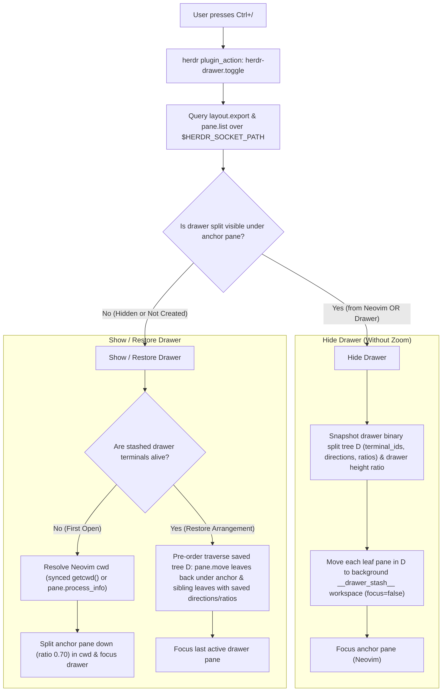
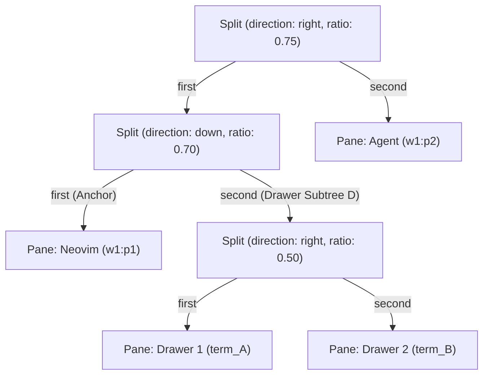

# herdr-drawer

A VS Code-style persistent, multi-pane bottom terminal drawer for [herdr](https://herdr.dev), scoped to the current tab.

Press `Ctrl+/` from Neovim (or any pane) to open a bottom terminal drawer in your editor's current working directory. Split the drawer into multiple panes, resize them, close splits, and press `Ctrl+/` again from **either Neovim or the drawer terminal** to hide the drawer — **without zooming your editor pane or hiding sibling panes** (like an AI agent or side panel) beside it. Press `Ctrl+/` again to restore the exact same multi-pane split arrangement and running shell processes.

---

## Why Not Pane Zoom or Popups?

1. **Pane Zoom hides sibling panes**: In a typical layout with `Neovim` on the left and an `Agent` pane on the right, hiding a bottom split by zooming the `Neovim` pane expands `Neovim` across the entire tab — making the `Agent` pane disappear.
2. **Popup / Overlay panes are single-pane and ephemeral**: Built-in popup overlays only support a single terminal pane (no inner horizontal/vertical splits) and terminate the process when closed.

`herdr-drawer` solves both problems by manipulating only the drawer subtree in the tab's binary `TileLayout` tree over `herdr`'s Unix socket (`$HERDR_SOCKET_PATH`).

---

## Visual Layout

### 1. Drawer Closed (Initial / Hidden State)
Your editor and any side-by-side panes (such as an `Agent` pane) sit alongside each other cleanly:

```text
+------------------------------------------+------------------------+
|                                          |                        |
|                                          |                        |
|                  Neovim                  |         Agent          |
|                 (w1:p1)                  |        (w1:p2)         |
|          cwd: ~/dev/my-project           |                        |
|                                          |                        |
|                                          |                        |
+------------------------------------------+------------------------+
```

### 2. Press `Ctrl+/` -> Drawer Opens Beneath Neovim
A bottom terminal drawer opens directly beneath `Neovim` (default 30% height) in `Neovim`'s active working directory (`getcwd()`), while the `Agent` pane on the right remains untouched:

```text
+------------------------------------------+------------------------+
|                                          |                        |
|                  Neovim                  |                        |
|                 (w1:p1)                  |                        |
|                                          |         Agent          |
+------------------------------------------+        (w1:p2)         |
| > zsh (~/dev/my-project)                 |                        |
|   Drawer Pane 1 (term_A)                 |                        |
+------------------------------------------+------------------------+
```

### 3. Split & Arrange Multiple Panes Inside the Drawer
Split panes inside the drawer using either standard `herdr` split keybindings or `herdr-drawer`'s split actions:

```text
+------------------------------------------+------------------------+
|                                          |                        |
|                  Neovim                  |                        |
|                 (w1:p1)                  |                        |
|                                          |         Agent          |
+--------------------+---------------------+        (w1:p2)         |
| > npm run dev      | > git status        |                        |
|   Drawer 1 (term_A)|   Drawer 2 (term_B) |                        |
+--------------------+---------------------+------------------------+
```

### 4. Press `Ctrl+/` Again (from Neovim or the Drawer) -> Drawer Hides
Pressing `Ctrl+/` from **either** `Neovim` or any drawer pane snapshots the drawer's binary split tree (`Split(right, 0.5, term_A, term_B)` + drawer height ratio) and moves the live drawer panes into a background `__drawer_stash__` workspace. `Neovim` reclaims its full height while `Agent` (`w1:p2`) stays visible. Pressing `Ctrl+/` again restores `term_A` and `term_B` in the exact same split arrangement.

---

## How It Works



### Split-Tree Snapshot & Pre-Order Reconstruction

In `herdr`, every tab layout is a binary tree of `Split` and `Pane` nodes. When the anchor pane (`w1:p1`) is split `down` to create the drawer, any subsequent splits inside the drawer live inside the `second` child of that `down` split:



- **Hiding**: `herdr-drawer` exports `DrawerSplit.second` as a tree of immutable `terminal_id`s (`term_A`, `term_B`) along with each split's `direction` and `ratio`, then moves each leaf pane to `__drawer_stash__`. Removing those leaves collapses `DrawerSplit` back into `EditorPane` (`w1:p1`) without touching `AgentPane` (`w1:p2`).
- **Unhiding**: Because `pane.move` into a tab replaces a target leaf `L` with `Split(direction, ratio, L, moved_pane)`, traversing the saved binary tree `D` in **pre-order** reconstructs any arbitrary combination of nested horizontal and vertical splits with their exact ratios.

---

## Requirements

- `herdr` `>= 0.7.0`
- Go `>= 1.22` (used to build the fast native socket client `bin/herdr-drawer`; `drawer.sh` compiles it automatically on first run if needed)
- macOS or Linux

---

## Installation

### 1. Install or Link the Plugin in `herdr`

From a local checkout:

```bash
git clone https://github.com/iancharters/herdr-drawer.git ~/dev/herdr-plugins/herdr-drawer
cd ~/dev/herdr-plugins/herdr-drawer
make link
```

Or link directly with the `herdr` CLI:

```bash
herdr plugin link ~/dev/herdr-plugins/herdr-drawer --enabled
```

Verify the plugin actions are registered:

```bash
herdr plugin action list --plugin herdr-drawer
```

### 2. Bind `Ctrl+/` in `~/.config/herdr/config.toml`

Add the following to `~/.config/herdr/config.toml`:

```toml
# Herdr Terminal Drawer

[[keys.command]]
key = "ctrl+/"
type = "plugin_action"
command = "herdr-drawer.toggle"
description = "toggle terminal drawer"
```

*(Optional)* You can also bind dedicated shortcuts to split panes inside the drawer, or simply use your existing `herdr` split keybindings (`prefix+s`, `prefix+v`, etc.):

```toml
[[keys.command]]
key = "prefix+alt+v"
type = "plugin_action"
command = "herdr-drawer.split-right"
description = "split terminal drawer right"

[[keys.command]]
key = "prefix+alt+s"
type = "plugin_action"
command = "herdr-drawer.split-down"
description = "split terminal drawer down"
```

Reload `herdr`'s configuration (`prefix+shift+r`) after saving `config.toml`.

### 3. Configure Neovim

To ensure the drawer always opens in Neovim's active working directory (even when you change directories inside Neovim via `:cd`, `:lcd`, `:tcd`, or a file explorer plugin) and to provide `:HerdrDrawer*` commands and fallback `<C-/>` keymaps, copy [`example/herdr-drawer.lua`](example/herdr-drawer.lua) into your Neovim configuration:

```bash
mkdir -p ~/.config/nvim/plugin
cp ~/dev/herdr-plugins/herdr-drawer/example/herdr-drawer.lua ~/.config/nvim/plugin/herdr-drawer.lua
```

Or source it from your `init.lua` / `lua/config/keymaps.lua`:

```lua
dofile(vim.fn.expand("~/dev/herdr-plugins/herdr-drawer/example/herdr-drawer.lua"))
```

#### Full `example/herdr-drawer.lua`

```lua
-- herdr-drawer.lua — Neovim integration for herdr-drawer
if not vim.env.HERDR_PANE_ID or vim.env.HERDR_PANE_ID == "" then
  return
end

local uv = vim.uv or vim.loop

local function get_uid()
  if uv and uv.getuid then
    return uv.getuid()
  end
  return tonumber(vim.fn.system("id -u")) or 0
end

local state_dir = string.format("/tmp/herdr-drawer-%d", get_uid())
local cwd_dir = state_dir .. "/cwd"
local sanitized_pane_id = (vim.env.HERDR_PANE_ID or ""):gsub(":", "_")

local function sync_nvim_cwd()
  local cwd = vim.fn.getcwd()
  if not cwd or cwd == "" then
    return
  end
  vim.fn.mkdir(cwd_dir, "p", "0700")
  local path = cwd_dir .. "/" .. sanitized_pane_id
  local f = io.open(path, "w")
  if f then
    f:write(cwd)
    f:close()
  end
end

local group = vim.api.nvim_create_augroup("HerdrDrawerCwdSync", { clear = true })
vim.api.nvim_create_autocmd({ "VimEnter", "DirChanged", "BufEnter", "WinEnter" }, {
  group = group,
  callback = sync_nvim_cwd,
})
sync_nvim_cwd()

local cached_runner = nil
local function resolve_drawer_runner()
  if vim.g.herdr_drawer_bin and vim.g.herdr_drawer_bin ~= "" then
    return vim.g.herdr_drawer_bin
  end
  if cached_runner then
    return cached_runner
  end

  local plugins_json = vim.fn.expand("~/.config/herdr/plugins.json")
  if vim.fn.filereadable(plugins_json) == 1 then
    local ok, content = pcall(vim.fn.readfile, plugins_json)
    if ok and content then
      local decoded_ok, plugins = pcall(vim.json.decode, table.concat(content, "\n"))
      if decoded_ok and type(plugins) == "table" then
        for _, p in ipairs(plugins) do
          if type(p) == "table" and p.plugin_root and (p.plugin_id == "herdr-drawer" or (type(p.plugin_id) == "string" and p.plugin_id:match("%.herdr%-drawer$"))) then
            local bin = p.plugin_root .. "/bin/herdr-drawer"
            if vim.fn.executable(bin) == 1 then
              cached_runner = bin
              return cached_runner
            end
            local script = p.plugin_root .. "/drawer.sh"
            if vim.fn.filereadable(script) == 1 then
              cached_runner = script
              return cached_runner
            end
          end
        end
      end
    end
  end

  local fallback = vim.fn.expand("~/dev/herdr-plugins/herdr-drawer/drawer.sh")
  cached_runner = fallback
  return cached_runner
end

local function run_drawer(action, extra_args)
  sync_nvim_cwd()
  local runner = resolve_drawer_runner()
  local cmd = {
    runner,
    action,
    "--from-nvim",
    "--pane",
    vim.env.HERDR_PANE_ID,
    "--cwd",
    vim.fn.getcwd(),
  }
  if extra_args then
    for _, arg in ipairs(extra_args) do
      table.insert(cmd, arg)
    end
  end
  vim.fn.jobstart(cmd, { detach = true })
end

vim.api.nvim_create_user_command("HerdrDrawerToggle", function()
  run_drawer("toggle")
end, { desc = "Toggle herdr terminal drawer" })

vim.api.nvim_create_user_command("HerdrDrawerOpen", function()
  run_drawer("open")
end, { desc = "Open herdr terminal drawer" })

vim.api.nvim_create_user_command("HerdrDrawerClose", function()
  run_drawer("close")
end, { desc = "Close herdr terminal drawer" })

vim.api.nvim_create_user_command("HerdrDrawerSplitRight", function()
  run_drawer("split", { "--direction", "right" })
end, { desc = "Split herdr drawer pane right" })

vim.api.nvim_create_user_command("HerdrDrawerSplitDown", function()
  run_drawer("split", { "--direction", "down" })
end, { desc = "Split herdr drawer pane down" })

vim.keymap.set({ "n", "t" }, "<C-/>", function()
  run_drawer("toggle")
end, { desc = "Toggle herdr terminal drawer", silent = true })

vim.keymap.set({ "n", "t" }, "<C-_>", function()
  run_drawer("toggle")
end, { desc = "Toggle herdr terminal drawer", silent = true })
```

---

## Development

```bash
make build   # compile bin/herdr-drawer
make test    # run Go unit tests
make vet     # run go vet
make link    # build and link plugin into herdr
```

## License

[MIT](LICENSE)
