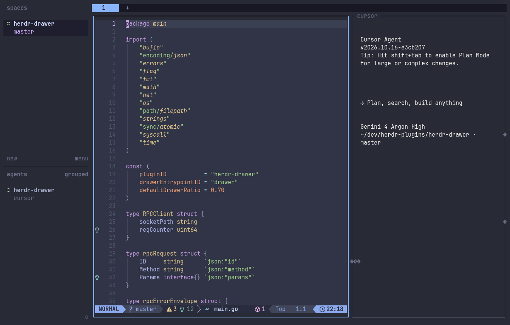

# herdr-drawer



A VS Code-style persistent, multi-pane bottom terminal drawer for [herdr](https://herdr.dev), scoped to the current tab.

Press `Ctrl+/` from Neovim (or any pane) to open a bottom terminal drawer in your editor's current working directory. Split the drawer into multiple panes, resize them, close splits, and press `Ctrl+/` again from **either Neovim or the drawer terminal** to hide the drawer — **without zooming your editor pane or hiding sibling panes** (like an AI agent or side panel) beside it. Press `Ctrl+/` again to restore the exact same multi-pane split arrangement and running shell processes.

---

## Requirements

- `herdr` `>= 0.7.0`
- macOS or Linux

---

## Installation

### 1. Install the Plugin in `herdr`

```bash
herdr plugin install iancharters/herdr-drawer
```

During installation, `herdr` runs the plugin's `[[build]]` step (`scripts/build.sh`) once to download the prebuilt `herdr-drawer` binary for your OS/architecture from GitHub Releases into the plugin's `bin/herdr-drawer` directory (falling back to `go build` if Go is installed and no release asset is found).

Or from a local checkout:

```bash
git clone https://github.com/iancharters/herdr-drawer.git ~/dev/herdr-plugins/herdr-drawer
cd ~/dev/herdr-plugins/herdr-drawer
make link
```

Verify the plugin actions are registered:

```bash
herdr plugin action list --plugin herdr-drawer
```

### 2. Bind `Ctrl+/` in `~/.config/herdr/config.toml`

Add the following to `~/.config/herdr/config.toml`:

```toml
# Herdr Terminal Drawer

[[keys.command]]
key = "ctrl+/"
type = "plugin_action"
command = "herdr-drawer.toggle"
description = "toggle terminal drawer"
```

This remains the default behavior out of the box. Without any profile config, `herdr-drawer` opens a bottom drawer and preserves terminal state across hide/show.

*(Optional)* You can also bind dedicated shortcuts to split panes inside the drawer, or simply use your existing `herdr` split keybindings (`prefix+s`, `prefix+v`, etc.):

```toml
[[keys.command]]
key = "prefix+alt+v"
type = "plugin_action"
command = "herdr-drawer.split-right"
description = "split terminal drawer right"

[[keys.command]]
key = "prefix+alt+s"
type = "plugin_action"
command = "herdr-drawer.split-down"
description = "split terminal drawer down"
```

Reload `herdr`'s configuration (`prefix+shift+r`) after saving `config.toml`.

### 2.1 Optional: profile-driven utility panes

You can define named profiles in:

```text
~/.config/herdr/plugins/config/herdr-drawer/profiles.toml
```

Example:

```toml
default_profile = "default"

[profiles.default]
placement = "down"        # down|up|left|right
size_ratio = 0.30         # percent of screen used by utility pane
persist_on_hide = true    # true = hide/unhide; false = restart on next open

[profiles.cursorRight]
placement = "right"
size_ratio = 0.35
persist_on_hide = true
command = "cursor agent --cwd {{cwd}}"

[profiles.opencodeLeft]
placement = "left"
size_ratio = 0.35
persist_on_hide = false
command = "opencode --project {{cwd}}"
```

`command` runs only when a new session is created for that profile. `{{cwd}}` (or `${cwd}`) is replaced with the anchor pane cwd.

Bind arbitrary keys to specific profiles:

```toml
[[keys.command]]
key = "ctrl+alt+/"
type = "shell"
command = "/absolute/path/to/herdr-drawer/bin/herdr-drawer toggle --profile default"
description = "toggle default drawer profile"

[[keys.command]]
key = "prefix+alt+c"
type = "shell"
command = "\"$HERDR_DRAWER_BIN\" toggle --profile cursorRight"
description = "toggle cursor utility pane"

[[keys.command]]
key = "prefix+alt+o"
type = "shell"
command = "\"$HERDR_DRAWER_BIN\" toggle --profile opencodeLeft"
description = "toggle opencode utility pane"
```

If you do not set `HERDR_DRAWER_BIN`, use the absolute path to `bin/herdr-drawer` in your installed plugin directory.

### 3. Configure Neovim

To ensure the drawer always opens in Neovim's active working directory (even when you change directories inside Neovim via `:cd`, `:lcd`, `:tcd`, or a file explorer plugin) and to provide `:HerdrDrawer*` commands and fallback `<C-/>` keymaps, run the interactive setup command:

```bash
# From inside herdr (opens an interactive setup popup):
herdr plugin action invoke herdr-drawer.setup

# Or from a local checkout in your terminal:
make setup
```

You will be prompted for the destination path (defaulting to `~/.config/nvim/lua/plugins/herdr-drawer.lua` — press `Enter` to accept or type a custom path). It installs a small loader that locates `herdr-drawer`'s installed `plugin_root` in `~/.config/herdr/plugins.json` and loads `editor/nvim.lua` directly from the `herdr` plugin directory. Restart Neovim after running setup.

---

## How It Works

### Why Not Pane Zoom or Popups?

1. **Pane Zoom hides sibling panes**: In a typical layout with `Neovim` on the left and an `Agent` pane on the right, hiding a bottom split by zooming the `Neovim` pane expands `Neovim` across the entire tab — making the `Agent` pane disappear.
2. **Popup / Overlay panes are single-pane and ephemeral**: Built-in popup overlays only support a single terminal pane (no inner horizontal/vertical splits) and terminate the process when closed.

`herdr-drawer` solves both problems by manipulating only the drawer subtree in the tab's binary `TileLayout` tree over `herdr`'s Unix socket (`$HERDR_SOCKET_PATH`).

### Visual Layout

#### 1. Drawer Closed (Initial / Hidden State)
Your editor and any side-by-side panes (such as an `Agent` pane) sit alongside each other cleanly:

```text
+------------------------------------------+------------------------+
|                                          |                        |
|                                          |                        |
|                  Neovim                  |         Agent          |
|                 (w1:p1)                  |        (w1:p2)         |
|          cwd: ~/dev/my-project           |                        |
|                                          |                        |
|                                          |                        |
+------------------------------------------+------------------------+
```

#### 2. Press `Ctrl+/` -> Drawer Opens Beneath Neovim
A bottom terminal drawer opens directly beneath `Neovim` (default 30% height) in `Neovim`'s active working directory (`getcwd()`), while the `Agent` pane on the right remains untouched:

```text
+------------------------------------------+------------------------+
|                                          |                        |
|                  Neovim                  |                        |
|                 (w1:p1)                  |                        |
|                                          |         Agent          |
+------------------------------------------+        (w1:p2)         |
| > zsh (~/dev/my-project)                 |                        |
|   Drawer Pane 1 (term_A)                 |                        |
+------------------------------------------+------------------------+
```

#### 3. Split & Arrange Multiple Panes Inside the Drawer
Split panes inside the drawer using either standard `herdr` split keybindings or `herdr-drawer`'s split actions:

```text
+------------------------------------------+------------------------+
|                                          |                        |
|                  Neovim                  |                        |
|                 (w1:p1)                  |                        |
|                                          |         Agent          |
+--------------------+---------------------+        (w1:p2)         |
| > npm run dev      | > git status        |                        |
|   Drawer 1 (term_A)|   Drawer 2 (term_B) |                        |
+--------------------+---------------------+------------------------+
```

#### 4. Press `Ctrl+/` Again (from Neovim or the Drawer) -> Drawer Hides
Pressing `Ctrl+/` from **either** `Neovim` or any drawer pane snapshots the drawer's binary split tree (`Split(right, 0.5, sess_A, sess_B)` + drawer height ratio) and closes the drawer panes in `herdr` while keeping their underlying shells alive inside a single background multiplexer daemon (`herdr-drawer daemon`). `Neovim` reclaims its full height, `Agent` (`w1:p2`) stays visible, and **no extra workspace or tab ever appears in `herdr`'s workspace or tab bars**. Pressing `Ctrl+/` again recreates the split tree via `plugin.pane.open` and re-attaches each pane to its persistent PTY session in the daemon with full screen replay.

### Single Multiplexer Daemon & Event-Driven Lifecycle (`events.subscribe`)

- **Single Per-Server Daemon (`herdr-drawer daemon`)**: One lightweight background process per `herdr` server listens on `/tmp/herdr-drawer-<uid>/daemon.sock` and multiplexes all drawer PTY sessions (`map[session_id]*ptySession`) along with a `128 KB` screen replay ring buffer per pane.
- **Zero-Polling Push Subscriptions (`events.subscribe`)**: The daemon holds a single persistent connection to `$HERDR_SOCKET_PATH` subscribed to `pane.created`, `pane.closed`, `tab.closed`, and `workspace.closed`:
  - **Automatic Native Split Adoption**: When you split a drawer pane using standard `herdr` keybindings (`prefix+v`, `prefix+s`, `prefix+-`), `herdr` emits `pane_created`. The daemon immediately detects the new native split leaf inside the drawer subtree, allocates a persistent PTY session for it (inheriting the sibling drawer session's `cwd`), and swaps it in-place in the binary split tree so both split geometry (`direction` and `ratio`) and shell state survive hide/unhide.
  - **Zero-CPU Idle & Instant Cleanup**: While idle, the daemon blocks on kernel socket reads (`kqueue` on macOS, `epoll` on Linux) with **0 timers and 0% CPU**. Closing a drawer pane, tab, or workspace reconciles orphaned PTYs immediately, and stopping `herdr` wakes the socket with `EOF` in `<1ms` to tear down all drawer shells.

### Split-Tree Snapshot & Pre-Order Reconstruction

- **Hiding**: `herdr-drawer` exports `DrawerSplit.second` as a binary tree of persistent `session_id`s (`sess_A`, `sess_B`) along with each split's `direction` and `ratio`, then closes the drawer panes in `herdr`. Removing those leaves collapses `DrawerSplit` back into `EditorPane` (`w1:p1`) without touching `AgentPane` (`w1:p2`) and without creating any stash workspace in `herdr`'s sidebar.
- **Unhiding**: Traversing the saved binary tree `D` in **pre-order** via `plugin.pane.open` and `layout.set_split_ratio` reconstructs any arbitrary combination of nested horizontal and vertical splits with their exact ratios and re-attaches each pane (`herdr-drawer attach`) to the background multiplexer daemon (`herdr-drawer daemon`), replaying the ring buffer so output and running processes are preserved seamlessly.

---

## Development

```bash
make build   # compile bin/herdr-drawer from source
make setup   # interactively install the Neovim plugin loader
make test    # run Go unit tests
make vet     # run go vet
make link    # build and link local checkout into herdr
```

## License

[MIT](LICENSE)
